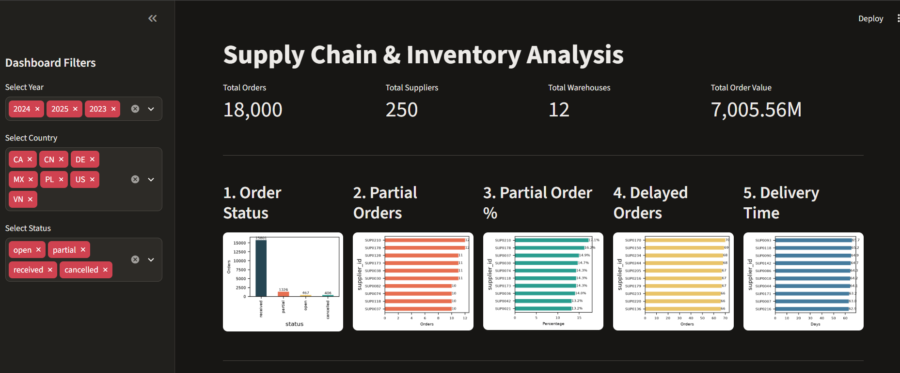
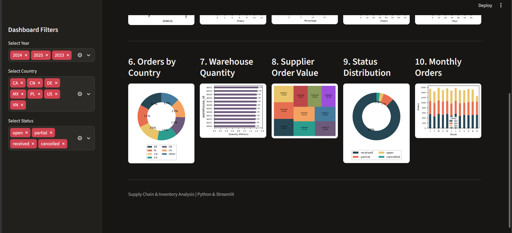

# Supply Chain & Inventory Analysis using Python

## Project Overview

This project focuses on analysing supply chain and inventory data to understand order performance, supplier performance, warehouse operations and delivery delays.

The main objective is to identify patterns, monitor order statuses and generate useful business insights through Python data analysis and visualizations.

## Project Objectives

- Analyse overall purchase order performance.
- Identify suppliers with the highest number of partial orders.
- Compare supplier delivery performance.
- Analyse delayed deliveries and average delivery time.
- Understand order distribution across supplier countries.
- Identify warehouses with the highest ordered quantities.
- Analyse total order value by supplier.
- Create an interactive dashboard to present important insights.

## Tools and Technologies

- **Python** – Programming language
- **Pandas** – Data cleaning and data analysis
- **Matplotlib** – Data visualization
- **Squarify** – Treemap visualization
- **Streamlit** – Interactive dashboard
- **VS Code** – Development environment
- **Git & GitHub** – Version control and project hosting

## Dataset Information

The project uses a supply chain inventory dataset containing 18,000 purchase order records and 13 columns.

Some important columns include:

- Purchase Order ID
- Order Date
- Expected Delivery Date
- Actual Received Date
- Order Status
- Supplier ID
- Supplier Country
- Warehouse ID
- Quantity Ordered
- Quantity Received
- Order Value

## Business Problems Analysed

The project explores the following business questions:

1. How many orders have fewer items received than ordered?
2. Which suppliers have the highest number of partial orders?
3. Which suppliers have the highest percentage of partial orders?
4. Which suppliers have the most delayed deliveries?
5. Which suppliers have the longest average delivery time?
6. Which countries contribute the most purchase orders?
7. Which warehouses have the highest quantity ordered?
8. Which suppliers have the highest total order value?

## Data Visualizations

The project includes 10 visualizations:

- Order status comparison
- Top 10 suppliers by partial orders
- Top 10 suppliers by partial order percentage
- Top 10 suppliers by delayed deliveries
- Top 10 suppliers by average delivery time
- Orders by supplier country
- Warehouse-wise quantity ordered
- Top suppliers by total order value
- Overall order status distribution
- Monthly order trend by year

## Interactive Dashboard

An interactive dashboard was developed using Streamlit.

It includes:
- Key performance indicators (KPIs)
- Year filter
- Supplier country filter
- Order status filter
- Interactive data visualizations

## Dashboard Preview

The following screenshots show the interactive Supply Chain & Inventory Analysis dashboard.





## Project Structure

```text
Supply_Chain_Inventory_Analysis/
│
├── supply_chain_inventory.csv
├── data_exploration.py
├── business_problems.py
├── charts.py
├── dashboard.py
├── requirements.txt
├── README.md
└── .gitignore
```

## How to Run the Project

**Step 1:** Clone the repository.

```bash
git clone https://github.com/mamtaqtech/supply-chain-project-python-DA.git
```

**Step 2:** Open the project folder.

**Step 3:** Install the required libraries.

```bash
pip install -r requirements.txt
```

**Step 4:** Run the Streamlit dashboard.

```bash
streamlit run dashboard.py
```

## Key Learning Outcomes

Through this project, I gained practical experience in:

- Data cleaning and preprocessing using Pandas.
- Exploratory Data Analysis (EDA).
- Grouping and analysing supply chain data.
- Creating business-focused visualizations.
- Working with dates and delivery performance.
- Developing interactive dashboards using Streamlit.
- Managing and uploading projects using Git and GitHub.

## GitHub Repository

[View Project on GitHub](https://github.com/mamtaqtech/supply-chain-project-python-DA)

---

**Project:** Supply Chain & Inventory Analysis  
**Developed using:** Python and Streamlit